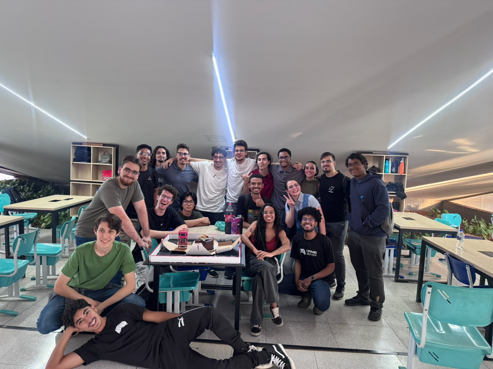

# Micromouse — PI1 2026.1, Grupo 02 (Prof. Hilmer)

Este projeto foi desenvolvido para a disciplina de Projeto Integrador 1 (PI1) da FCTE/UnB em 2026/1. O objetivo do desafio foi projetar e construir um robô Micromouse capaz de resolver labirintos 4x4 e 8x8 de forma totalmente autônoma, sem intervenção humana durante a corrida.

## O desafio

- Labirintos 4x4 e 8x8, com configuração de paredes definida pelos professores no dia da competição.
- Ponto de largada em um canto do labirinto, sorteado no momento da corrida.
- Cada célula do labirinto mede 18 cm de lado, com paredes de 1,2 cm de espessura.
- O objetivo é um bloco de 4 células (2x2) sem paredes entre si, no centro do labirinto.
- O robô precisa mapear o labirinto, alcançar esse bloco central e, em seguida, percorrê-lo pelo caminho mais curto conhecido.

## Estrutura do repositório

O projeto foi dividido em quatro núcleos: Eletrônica, Software, Estrutura e Energia. A organização de pastas segue o [template padrão do PI1](https://github.com/fcte-pi1/template):

| Pasta | Conteúdo |
|---|---|
| [`src/firmware`](src/firmware) | Firmware do Micromouse (ESP32/ESP-IDF): navegação, resolução de labirinto, controle de motores e sensores. |
| [`src/backend`](src/backend) | API (FastAPI) que recebe a telemetria do robô e persiste o histórico das corridas. |
| [`src/frontend`](src/frontend) | Interface web (React) para acompanhar o robô em tempo real durante a corrida. |
| [`hw`](hw) | Esquemáticos, PCBs e datasheets dos componentes eletrônicos. |
| [`mec`](mec) | Modelagem 3D, desenhos técnicos e montagem do chassi e do labirinto. |
| [`docs`](docs) | Documentação do projeto: EAP, relatório técnico, análise de riscos e seleção de componentes. |

## Minha participação

Atuei neste projeto como **líder do núcleo de Eletrônica**, assumindo o desenvolvimento do hardware, a implementação do firmware de baixo nível e a coordenação do núcleo. Minhas principais contribuições foram:

**Gestão e Integração**
- Gerenciamento de pessoas do núcleo de Eletrônica, organizando as demandas e o fluxo de trabalho da equipe.
- Coordenação e comunicação direta com os núcleos de **Estrutura** e **Energia** para garantir a integração física e elétrica do robô:
  - Alinhamento do dimensional da PCB e do posicionamento dos componentes em conjunto com a mecânica.
  - Auxílio na especificação, montagem e integração do pacote de baterias e do Sistema de Gerenciamento de Bateria (BMS).

**Hardware**
- Projeto do circuito eletrônico do robô, incluindo o desenvolvimento dos esquemáticos das PCBs (disponíveis no diretório [`hw`](hw)).
- Seleção e especificação dos componentes do sistema, contemplando o microcontrolador (ESP32), sensores e atuadores.

**Firmware**
- Desenvolvimento do firmware dedicado ao controle e acionamento dos motores e à leitura dos sensores de navegação.
- Implementação e validação da comunicação via barramento I2C.
- Calibração dos sensores embarcados (ToF, giroscópio/IMU e encoders).

## Fluxo de execução do firmware

O `app_main` do firmware (`teste_navegacao.cpp`) segue, em cada corrida, a seguinte sequência:

1. **Inicialização de hardware** — sobe o barramento I2C (bateria/INA226), inicializa os 3 sensores ToF usados (frontal, esquerda, direita), o giroscópio (MPU9250), os encoders (via PCNT) e os motores. A conexão Wi-Fi é disparada em background, sem bloquear o boot.
2. **Seleção de largada** — com o robô parado, toques curtos no botão único alternam entre as combinações de tamanho do labirinto (4x4/8x8) e lado de largada (esquerda/direita); segurar o botão (≥ 0,7 s) confirma a seleção, calibra o bias do giroscópio e dá a largada.
3. **Envio da configuração inicial e heartbeat** — envia o pacote de configuração (tipo 0) ao backend, se o Wi-Fi já estiver conectado, e inicia uma tarefa paralela que envia heartbeats (tipo 4) periodicamente até o fim da execução.
4. **Mapeamento** — a cada célula, lê as paredes com os sensores ToF e avança um passo da máquina de estados do labirinto (flood-fill), que decide a direção e aciona os comandos de giro/avanço do robô. Cada nova célula descoberta é reportada ao backend (tipo 1). O mapeamento só termina após visitar todas as células alcançáveis do bloco 2x2 central (confirmando que o objetivo está aberto e foi de fato alcançado) ou, em caso de bloqueio, envia o pacote de fim de corrida (tipo 3) com falha.
5. **Corrida rápida (fast run)** — após o mapeamento, o robô é reposicionado manualmente na largada; um novo aperto do botão envia a rota ótima calculada (tipo 2) e inicia a corrida rápida, que percorre o labirinto pelo caminho mais curto conhecido, otimizando trechos retos em uma única execução contínua. Ao concluir, envia o pacote de fim de corrida (tipo 3) com sucesso e a velocidade média.
6. **Monitoramento contínuo** — em paralelo às fases acima, a temperatura é verificada a cada passo; se ultrapassar o limiar crítico, a corrida é abortada, os motores são parados e os pacotes de alerta (tipo 5) e fim de corrida (tipo 3, sem sucesso) são enviados.


## Hardware

O sistema embarcado do Micromouse é dividido em duas PCBs interligadas por conectores JST (série 2223): a **Logic & Control Board**, responsável pelo processamento e navegação inercial, e a **Motor & Drive Board**, responsável pela alimentação, acionamento dos motores e leitura dos sensores de distância.

### Logic & Control Board

Concentra o microcontrolador **ESP32 DEVKIT**, que centraliza o processamento, a leitura da IMU (**MPU-9250**, via I2C) usada na navegação inercial, e o subsistema de acionamento (chaves SW-1/SW-2) para controle manual de início/parada. Também traz os test points para depuração dos sinais STBY, XSHUT, SW e dos canais dos encoders (C1/C2).


### Motor & Drive Board

Concentra o sistema de energia e o sistema de sensoriamento/atuação:

- **Regulador de tensão** (MP1584EN), responsável por converter a tensão da bateria para o nível lógico usado pelo restante do sistema;
- **Monitoramento de energia** via módulo **INA226** (I2C), usado para leitura de tensão, corrente e potência da bateria;
- **Driver de motores TB6612FNG**, que aciona os dois motores DC a partir dos sinais PWM/AI/BI do ESP32;
- **Sensores infravermelhos** (3x, comunicação I2C com pino XSHUT individual para configuração de endereço), usados para mapeamento e detecção de paredes do labirinto;
- Conectores de interligação com os motores, encoders e com a Logic & Control Board.


### Estrutura de arquivos

```
hw/
└── PCB/
    ├── Logic & Control Board/
    │   └── SCH_PCB_2_2026-06-05_page-0001.jpg
    └── Motor & Drive Board/
        └── SCH_PCB_1_2026-06-30_page-0001.jpg
```


## Demonstração

Vídeo da execução completa no labirinto 8x8: https://youtu.be/1a2v_xoSXcU

Vídeo da explicação do funcionamento do robô: https://youtu.be/TcLgV6eDGfE
<p>
  
</p>

## Sobre este fork

Este repositório é um fork do projeto original de equipe, mantido para referência pessoal do trabalho realizado.
